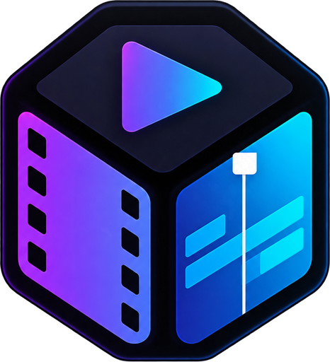

<p align="center">
  
</p>

<h1 align="center">JBD</h1>

<p align="center"><b>The video editor by Jabrod.</b> Part of Jabrod Art.</p>

<p align="center">
  <a href="https://apps.microsoft.com/detail/9P0KS6185QSX">Microsoft Store</a> ·
  <a href="https://jabrod.com/jbd">Download</a> ·
  <a href="https://jabrod.com/art">Jabrod Art</a> ·
  <a href="https://jabrod.com/jbd/changelog">Changelog</a>
</p>

JBD is a desktop video editor for Windows 10 and 11. It provides a multi-track timeline with
ripple, roll, slip and slide trims; colour grading with curves, wheels, looks and scopes; audio
mixing with loudness meters; titles and editable caption tracks with on-device speech to text;
and export up to 4K.

JBD is the first product of [Jabrod Art](https://jabrod.com/art), Jabrod's open-source creative
suite. It is built on [FilmCraft](https://github.com/storytold/filmcraft), an open-source,
pure-Rust video editor. FilmCraft's original README is in
[docs/FILMCRAFT-README.md](docs/FILMCRAFT-README.md).

## Install

| | |
|---|---|
| Microsoft Store | [apps.microsoft.com/detail/9P0KS6185QSX](https://apps.microsoft.com/detail/9P0KS6185QSX) |
| Direct download | [jabrod.com/jbd](https://jabrod.com/jbd) |

JBD is free. JBD Pro, available from within the application, adds further features. A Jabrod
account is required to sign in; projects and media remain on your computer.

## Build from source (Windows)

Requirements: Rust (stable, MSVC toolchain) and the Visual Studio 2022 C++ Build Tools.

```powershell
winget install -e --id Rustlang.Rustup
winget install -e --id Microsoft.VisualStudio.2022.BuildTools --override "--wait --passive --add Microsoft.VisualStudio.Workload.VCTools --includeRecommended"
```

Then run `start-jbd.cmd` in the repository root, or from a terminal:

```powershell
.\start-jbd.cmd          # Home screen
.\start-jbd.cmd demo     # opens the demo project
.\start-jbd.cmd control  # also starts the control server on port 9876, for agents
```

The script runs `cargo run -p filmcraft` with at most six parallel compile jobs, to keep memory
use within 16 GB. The first build compiles about 50 crates and takes some time; subsequent builds
are incremental. The executable is `target\debug\jbd.exe`. For an optimised build, use
`cargo run -p filmcraft --release`.

Before submitting a change, run `cargo xtask ci`. Contribution guidelines are in
[docs/contributing.md](docs/contributing.md).

## Documentation

- [Architecture](docs/architecture.md)
- [Control protocol for agents](docs/control-protocol.md)
- [Captions](docs/captions.md)
- [Release process](docs/jbd/RELEASE.md)

## Licence

JBD is available under either the [Apache License 2.0](LICENSE-APACHE) or the
[MIT License](LICENSE-MIT), at your option. The notices in `NOTICE` and `ATTRIBUTION.md` must be
retained.

The JBD and Jabrod names and logos, including the files in `assets/jbd/`, are trademarks of
Jabrod and are not licensed under the above terms (see `assets/jbd/LICENSE-brand.txt`).

## Contact

[contact@jabrod.com](mailto:contact@jabrod.com) · [jabrod.com](https://jabrod.com)
